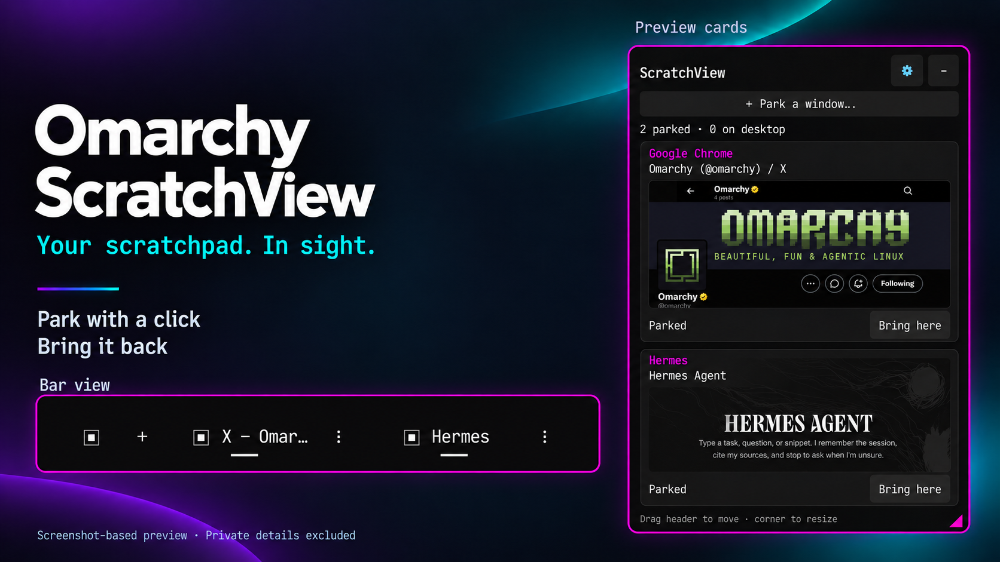

# Omarchy ScratchView

Your scratchpad. In sight.

Put a window away. See where it went. Bring it back with a click.

Omarchy ScratchView makes the existing Omarchy scratchpad visible. It is for anyone who prefers clicking to remembering another key combination—or simply wants to see which windows they have parked.



*Screenshot-based promotional composition using the public Omarchy X profile and Hermes welcome screen. Private details excluded; parked states are illustrative. Third-party names and marks identify the applications shown, not an endorsement.*

## What it does

- **Park with the mouse.** Use **Park a window…** to choose a normal desktop window.
- **Bring it back.** Retrieve a parked window to your current desktop; **Put back** returns it to the scratchpad.
- **Keep your place.** Retrieved windows keep their cards, marked **On desktop**. Click a card to focus that window without moving it between desktops.
- **Clear cards without closing apps.** Dismiss an on-desktop card, with 20 seconds to undo the last dismissal. Parked cards cannot be dismissed.
- **Choose your view.** A movable, resizable floating panel with preview cards or compact icon/title rows, or a horizontal bar strip with up to two windows and overflow into the panel.
- **Tuck it away.** Hide to the bar icon and reopen even when empty. The panel automatically hides when the last managed card disappears, after any Undo opportunity.
- **Follow your theme.** Active Omarchy palette, system monospace font in the panel and native shell styling in the bar. Colours update on refresh; restart the panel after changing its font.

ScratchView uses `special:scratchpad`, preserving existing shortcuts. It manages windows, not individual browser tabs. It is not another dock or an embedded browser.

## Requirements

Omarchy Quattro with its Quickshell-based shell and Hyprland Lua dispatcher. Runtime dependencies: Python 3.11+ (standard library only), Quickshell with Hyprland/Wayland support, `hyprctl`, and fontconfig (`fc-match`). Normal plugin installation also uses Git and Omarchy's plugin commands. No pip packages, root access, network account, service or timer is required by ScratchView.

Legacy Waybar-based Omarchy and non-Lua Hyprland dispatchers are not supported. Fullscreen stacking, thumbnails and multi-monitor behaviour depend on the compositor; exhaustive compatibility is not claimed. The floating panel is above normal windows, not the lockscreen.

## Install

Review the source first: desktop plugins execute unsandboxed as your user.

```sh
omarchy plugin add https://github.com/shaggyrs6-netizen/omarchy-scratchview --enable
```

Follow Omarchy's confirmation and placement prompts; the suggested section is **right**. Click **▣** to open the panel. It launches a separate Quickshell panel only when requested; the bar widget runs in the main shell. No separate desktop launcher or panel autostart is installed.

If added without enabling:

```sh
omarchy plugin enable shaggyrs6.scratchview
```

For custom bars such as Shibumi, use that bar's supported widget settings. The installed plugin must be a **real directory**, not a development symlink: Shibumi's catalogue rejects symlinked plugin metadata. Regular Omarchy installation creates a real directory. Do not replace a custom bar's layout with a stock one.

An existing local prototype with this same ID must be backed up and migrated separately; do not overwrite it. The native installer rejects duplicate IDs. Close the old prototype panel first to avoid two panels sharing tracking state. Keep its source/config backup until the release has been tested.

## Controls

Drag the header to move; drag the bottom-right corner to resize. Default size is 360 × 660 logical pixels, with a 200-pixel minimum width. The gear opens settings for **Floating panel / Horizontal bar** and **Preview cards / Compact list**. The panel is available in either view.

The bar strip provides **+** for the parking picker, window chips to bring/focus, **⋮** or right-click for actions, and **+N more** when needed. Right-click **▣** for settings. A vertical desktop bar falls back to the restore icon. The bar count includes retained on-desktop cards, not just parked windows.

**−** hides the panel; **Quit ScratchView** in settings closes only the panel. Neither closes or moves your applications. Click the bar icon to launch it again. New parked windows do not force a hidden panel open.

## Privacy and local files

The backend reads window metadata from Hyprland. Previews stay local and are not saved or sent over the network; compact mode disables preview capture. Titles/previews can be visible in a screen share. The plugin makes no application network requests; Git installation/updates are separate.

- Preferences and geometry: `${XDG_STATE_HOME:-$HOME/.local/state}/omarchy-scratchview/`.
- Session tracking and last-dismiss Undo: `$XDG_RUNTIME_DIR/omarchy-scratchview/`, with window addresses and hashed identities, not saved title text.

Window actions validate addresses and identity tokens and pass arguments directly to `hyprctl`, without shell evaluation. Other special workspaces are excluded. These safeguards are not a security audit or sandbox.

## Update and rollback

Quit the panel from its settings before updating. Save the installed repository's current commit (`git -C "$HOME/.config/omarchy/plugins/shaggyrs6.scratchview" rev-parse HEAD`) and copy that directory to a private backup outside the plugin search path before upgrading.

```sh
omarchy plugin update shaggyrs6.scratchview
```

Reopen using the bar icon. Native updates follow upstream; they are not automatically pinned to a marketplace-reviewed commit. To roll back, disable the widget, quit the panel, preserve the newer directory outside the search path, restore your known-good backup as a regular directory, then rescan with `omarchy-shell shell rescanPlugins` and re-enable. Do not discard local changes or restore an old symlink.

## Remove

First use **Quit ScratchView** in panel settings. If the panel is unresponsive, target only its exact installed configuration:

```sh
quickshell ipc -p "$HOME/.config/omarchy/plugins/shaggyrs6.scratchview" call scratchview quit
```

An error here can simply mean the panel is not running. Then:

```sh
omarchy plugin remove shaggyrs6.scratchview
```

Review Omarchy's confirmation: removal deletes a Git-managed plugin checkout. Back up any local edits first. ScratchView does not delete its saved preferences or close, retrieve or relocate parked app windows; existing scratchpad shortcuts remain available. Preferences can be retained for reinstall. Do not run broad recursive deletion commands to clear them.

## Development and checks

Version 1.0.1 fixes automatic HTML interpretation of window-title tooltips in both panel and bar. See [security fix and regression evidence](SECURITY-FIX-1.0.1.md). Existing 1.0.0 installations should update.

```sh
python3 -m unittest discover -s . -q
node test_visibility.cjs
omarchy plugin validate .
```

Node.js is test-only. Tests use synthetic windows/mocked dispatch, not real user-window moves. See [RELEASE-CHECKS.md](RELEASE-CHECKS.md) for validation scope. Stage and test changes outside the installed folder before deployment; live QML hot reload can interrupt your bar.

## Licence

MIT © 2026 Lee Shand. See [LICENSE](LICENSE). The licence covers this project's original work, not third-party branding or application content appearing in the preview.
